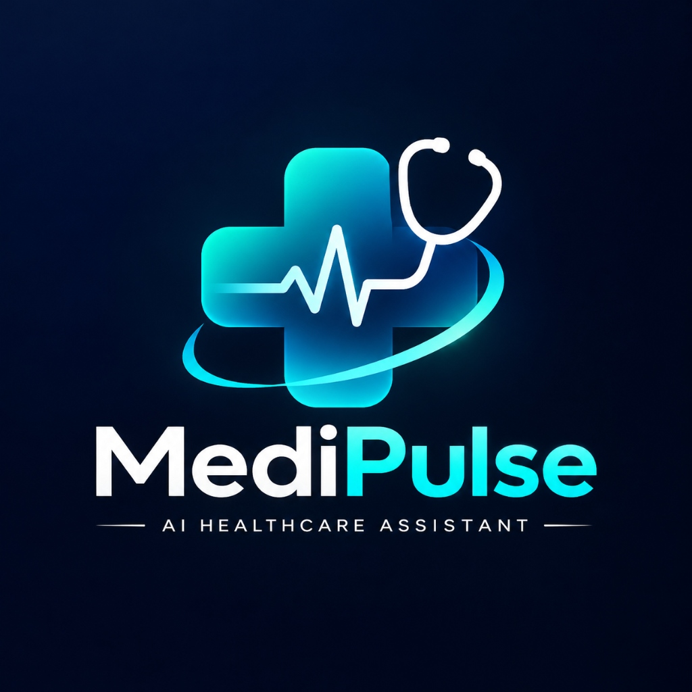
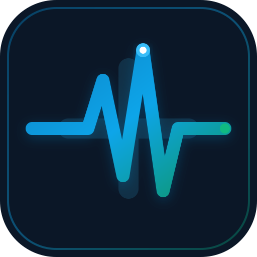

<<<<<<< HEAD
# MediPulse AI

<p align="center">
  
</p>

MediPulse AI is an intelligent system to help patient(users) to get rid of there diseases by many features of our website
=======
# MediPulse

<p align="center">
  
</p>

<p align="center">
  <strong>Understand health information. Find evidence. Make informed next steps.</strong>
</p>

<p align="center">
  <a href="https://github.com/sharadpawarspeaks/MediPulse/actions"></a>
  <a href="https://ai.google.dev/gemma"></a>
  <a href="/manifest.json"></a>
  <a href="LICENSE"></a>
  <a href="https://github.com/shravanshidruk16/MediNova-AI-Hack2Skill-x-Prompt-Wars-Challenge"></a>
</p>

---

## Overview & Mission

**MediPulse** is an open-source, evidence-first healthcare intelligence platform designed to empower patients, caregivers, and health advocates with verifiable medical information, plain-language clinical insights, and safe next steps.

Rather than acting as an ungrounded conversational chatbot that guesses medical diagnoses, MediPulse enforces **clinical safety guardrails**, **authoritative evidence retrieval (WHO, CDC, NIH MedlinePlus, PubMed)**, **deterministic emergency red-flag triage**, and **plain-language medical report translation**.

> **⚠️ Medical Disclaimer:** MediPulse is an educational and health literacy companion. It does NOT provide medical diagnoses, treatment plans, or emergency medical dispatch. Always consult a licensed clinician for healthcare decisions.

---

## Key Features & Innovations

### 1. 🩺 Dual-Layer Clinical Safety & LifeAlert
- **Layer 1 (Deterministic Red-Flag Rules):** Evaluates input in `<1ms` for acute life-threatening emergencies (myocardial infarction / chest pain radiating to arm, FAST stroke indicators, severe respiratory distress, anaphylaxis, massive hemorrhage).
- **Layer 2 (Google Gemma Guidance):** Explains urgent medical steps without delaying emergency dispatch.
- **Fail-Safe Operation:** Emergency alerts fire deterministically even if the LLM service is offline or unconfigured. Connects users directly to local emergency dispatch (`112` in India/EU, `911` in USA, `999` in UK).

### 2. 🔍 Evidence-First TruthCheck AI
- Evaluates health claims, popular myths, and viral misinformation against verified peer-reviewed research and public health agency consensus.
- Displays transparent citations, working links, publication dates, and an objective **Evidence Strength Score** (*Level A: Systematic Review & Agency Consensus*, *Level B: Clinical Trial / Peer-Reviewed Evidence*, *Level C: General Education*).

### 3. 📄 LabLens AI — Medical Report Translation (Innovation D)
- Upload laboratory PDF reports or paste clinical metrics.
- Uses `pypdf` to extract observed biomarkers, units, and reference ranges (e.g. Hemoglobin, Fasting Blood Sugar, HbA1c, Platelets, Creatinine, Total Cholesterol, TSH).
- Translates Latinate medical jargon into accessible plain English without diagnosing.
- Emphasizes that laboratory reference intervals vary across diagnostic analyzers and require physician correlation.

### 4. 🏥 Source-Grounded ClinicScope RAG (Innovation E)
- Scrapes and summarizes hospital/clinic websites to extract departments, 24x7 emergency facilities, insurance empanelment, and operating hours.
- **SSRF-Hardened Security:** Strictly prevents Server-Side Request Forgery by validating URL schemes and blocking DNS resolutions to `localhost`, RFC 1918 private subnets (`10.0.0.0/8`, `172.16.0.0/12`, `192.168.0.0/16`), loopback (`127.0.0.0/8`), and cloud metadata (`169.254.169.254`).
- Chunks webpage text and retrieves the most relevant sections using lightweight lexical BM25 ranking.

### 5. 📋 CarePrep AI — Doctor Appointment Worksheet (Innovation F)
- Synthesizes user symptoms, duration timeline, current medications, and allergies into a clean, printable checklist for consultations.
- Generates high-yield, targeted questions to ask the clinician during an outpatient visit.
- Supports 1-click browser printing and clean PDF export.

### 6. 🌐 Health Literacy & Multilingual Support (Innovation C)
- Toggle between reading-level modes: **Simple (Grade 6 Plain English)**, **Detailed (Clinical Differential)**, **Warning Signs Focus**, and **Questions for Doctor Focus**.
- Supports **Hindi (हिन्दी)** and Indian regional healthcare contexts.

### 7. 📲 Progressive Web App (PWA) for Android & Mobile
- Native Android app experience with Web App Manifest (`manifest.json`) and Service Worker (`sw.js`).
- Stale-while-revalidate caching for fast loads and a dedicated offline fallback page (`/offline`) with direct emergency hotlines.
- Maskable high-resolution icons (192px, 512px, SVG).

### 8. 🔒 Privacy by Design (Innovation B)
- Zero remote storage of identifiable health conversations.
- Optional user profile (age bracket, known health conditions, language) is saved strictly in browser `localStorage`.
- No tracking pixels, no telemetry leaks, and immediate in-memory destruction of uploaded lab report files.

---

## Architecture Diagram

```
+-------------------------------------------------------------------------+
|                  Client Layer (Responsive Web & Android PWA)            |
|     [Vanilla CSS Design System]   [Service Worker (sw.js)]   [Offline]  |
|     [HTML5 Accessible Shell]      [Client-side Privacy Context Profile]  |
+-------------------------------------------------------------------------+
                                    │
                                    ▼ (HTTPS / JSON REST API)
+-------------------------------------------------------------------------+
|                         Flask Application Layer                         |
|   ┌─────────────────────────────────────────────────────────────────┐   |
|   │ Middleware: Security Headers (CSP, X-Frame-Options, XSS Block)  │   |
|   │ Blueprints: Web Routes (/doctor, /clinic, /report, /visit-prep) │   |
|   │ API Routes (/api/lifealert, /api/healthsense, /api/truthcheck)  │   |
|   └─────────────────────────────────────────────────────────────────┘   |
+-------------------------------------------------------------------------+
                                    │
       ┌────────────────────────────┼────────────────────────────┐
       ▼                            ▼                            ▼
+---------------+          +------------------+         +------------------+
| Safety Engine |          | Evidence Engine  |         |   RAG Engine     |
| (Deterministic|          | (WHO / CDC / NIH |         | (SSRF Guardrail, |
| Clinical Red  |          | Curated Registry |         | Section Chunking,|
| Flag Rules)   |          | & Live Tavily)   |         | Lexical BM25)    |
+---------------+          +------------------+         +------------------+
       │                            │                            │
       └────────────────────────────┼────────────────────────────┘
                                    │
                                    ▼
+-------------------------------------------------------------------------+
|                   Google Gemma Model Service Layer                      |
|   ┌─────────────────────────────────────────────────────────────────┐   |
|   │ Primary Model: gemma-4-26b-a4b-it                               │   |
|   │ SDK: Official google-genai Python Client                        │   |
|   │ Fail-Safe: Tenacity Exponential Retries & Safe JSON Parser      │   |
|   │ Test Engine: GemmaMockEngine (Keyless Deterministic Fallback)   │   |
|   └─────────────────────────────────────────────────────────────────┘   |
+-------------------------------------------------------------------------+
```

---

## Quickstart & Local Setup

### Prerequisites
- Python 3.10+ (tested on Python 3.11, 3.12, 3.13, and 3.14)
- Git

### 1. Clone the Repository
```bash
git clone https://github.com/sharadpawarspeaks/MediPulse.git
cd MediPulse
```

### 2. Set Up Virtual Environment
```bash
# On Linux / macOS:
python -m venv venv
source venv/bin/activate

# On Windows (PowerShell):
python -m venv venv
.\venv\Scripts\Activate.ps1
```

### 3. Install Dependencies
```bash
pip install -r requirements.txt
```

### 4. Configure Environment Variables
Copy the template configuration file:
```bash
cp .env.example .env
```
Edit `.env` to configure your API keys:
```ini
# Google Gemma API Key (from Google AI Studio: https://aistudio.google.com/)
GEMINI_API_KEY=your_gemini_api_key_here

# Gemma Model Selection (Default: gemma-4-26b-a4b-it)
GEMMA_MODEL=gemma-4-26b-a4b-it

# Flask Secret
FLASK_SECRET_KEY=replace_with_a_secure_random_secret

# Optional live search (leave blank to use curated medical database)
TAVILY_API_KEY=
```
> **Note on Keyless Testing:** If you do not have an API key, leave `GEMINI_API_KEY` blank. MediPulse automatically detects missing credentials and runs in **deterministic mock mode** so you can evaluate the entire application and run all tests immediately without consuming API credits!

### 5. Run the Application
```bash
python app.py
```
Open your browser and navigate to: `http://localhost:5000`

---

## Automated Testing

MediPulse includes a comprehensive `pytest` test suite covering routing, security boundaries, clinical safety rules, RAG SSRF defenses, and model parsing:

```bash
pytest -v
```

### Test Suite Coverage:
- `tests/test_safety.py`: Deterministic cardiac, stroke, dyspnea, and emergency triage rules.
- `tests/test_rag_ssrf.py`: Strict blocking of `localhost`, private subnets (`10.x`, `192.168.x`), and cloud metadata (`169.254.169.254`).
- `tests/test_report.py`: PDF and text biomarker extraction for CBC, FBS, and HbA1c panels.
- `tests/test_routes.py`: Status validation on all web pages, manifest, service worker, and 11 API endpoints.
- `tests/test_gemma.py`: Safe JSON extraction, markdown backtick stripping, and transparency metadata attachment.

---

## Docker Deployment

You can run MediPulse in an isolated Docker container:

```bash
# Build and run with Docker Compose
docker compose up -d

# Check running status and health probe
docker compose ps
```
The application will be live at `http://localhost:5000`.

---

## API Reference

All API endpoints accept JSON POST requests and return structured JSON responses:

| Endpoint | Method | Required Payload | Purpose |
| :--- | :--- | :--- | :--- |
| `/api/lifealert` | `POST` | `{"symptoms": "..."}` | Dual-layer emergency red-flag triage |
| `/api/healthsense` | `POST` | `{"symptoms": "...", "reading_level": "simple", "language": "en"}` | Symptom awareness & triage |
| `/api/chat` | `POST` | `{"input": "...", "history": "..."}` | HealthGPT conversational assistant |
| `/api/truthcheck` | `POST` | `{"query": "..."}` | Medical claim verification & evidence grading |
| `/api/medisafe` | `POST` | `{"medicine": "..."}` | Medication safety, precautions & interactions |
| `/api/prevent` | `POST` | `{"focus_area": "..."}` | Preventive care & lifestyle blueprint |
| `/api/doctorlens` | `POST` | `{"doctor_name": "...", "location": "..."}` | Doctor credentials & practice overview |
| `/api/carefinder` | `POST` | `{"symptoms": "...", "location": "..."}` | Location-grounded care & facility discovery |
| `/api/clinicscope` | `POST` | `{"url": "..."}` | SSRF-protected clinic website RAG |
| `/api/report_analyze` | `POST` | `multipart/form-data` (file) or `{"report_text": "..."}` | Medical report biomarker translation |
| `/api/visit_prep` | `POST` | `{"chief_complaint": "...", "timeline": "..."}` | Print-ready doctor appointment prep sheet |
| `/api/health` | `GET` | *None* | Healthcheck & readiness probe |

---

## Upstream Project Attribution

MediPulse is built as a major architectural evolution of **MediNova**, originally created by **Shravan Shidruk**:
- **Original Source Project:** [MediNova AI Challenge Repository](https://github.com/shravanshidruk16/MediNova-AI-Hack2Skill-x-Prompt-Wars-Challenge)
- **Original Author:** Shravan Shidruk (MIT License)

### Enhancements & Novel Innovations in MediPulse:
1. **Google Gemma 4 Integration:** Replaced proprietary model calls with Google Gemma using the official `google-genai` SDK.
2. **Deterministic Clinical Safety Rule Engine:** Re-engineered LifeAlert to ensure red-flag emergency detection does not depend on LLM uptime.
3. **SSRF-Protected RAG:** Secured website analysis against private IP access, loopback probing, and cloud metadata theft.
4. **LabLens Report Understanding:** Added PDF/text laboratory report metric extraction and plain-language interpretation.
5. **CarePrep Appointment Generator:** Created clinical discussion sheets with print stylesheet (`@media print`) and PDF export.
6. **Progressive Web App (PWA):** Engineered a native Android PWA with service worker offline fallback and responsive mobile design.
7. **Evidence-First Architecture:** Integrated transparent source citations with Evidence Strength levels (Levels A–C).

---

## License

This project is licensed under the **MIT License** — see the [LICENSE](LICENSE) file for complete copyright and attribution details.
>>>>>>> origin/devFinal
